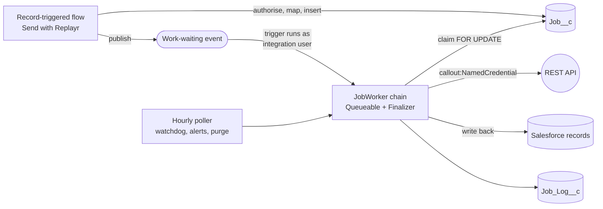

# Replayr

**Send Salesforce records to any outside system, with no code and no lost or duplicated calls.**

Replayr is a Salesforce app for admins. You point it at another system's API (your billing tool, ERP, shop, or anything with a REST API) and map your fields. Then you turn on a ready-made flow, and from then on your records are sent automatically.

## Why admins use it

Sending data from Salesforce to another system usually goes wrong in quiet ways:

| Without Replayr | With Replayr |
| --- | --- |
| A call fails and nobody notices until a customer complains. | Every call is logged. Failures appear in one list, and admins get an alert. |
| You can't tell whether a failed order went through. Resending it might charge the customer twice. | Replayr retries only calls you've marked safe to repeat. When it can't be sure, it asks you rather than guessing. |
| The integration needs a developer and custom code. | Set it up in clicks: a provider, an endpoint, a field mapping and a template flow. |
| API passwords end up in custom fields or flows. | Logins stay in Salesforce's own secure Named Credentials, and Replayr never sees them. |
| Every user needs access to the API login. | One dedicated integration user sends everything, in the background. |

## See it in action

This 15-minute walkthrough sets up Replayr from a fresh org and sends a first record, step by step.

https://github.com/user-attachments/assets/6ac85819-7c89-4524-b27f-886566c71f4a

If the player doesn't load, [download the video](docs/media/replayr-walkthrough.mp4) instead.

## Get started

**[Getting started guide](docs/getting-started.md).** Twelve plain-language steps, from install to your first record sent, with fixes for the common mistakes. It takes about 30 minutes, and no code.

For changing the integration user later, write-back flows and other details, see the [admin guide](docs/admin-guide.md).

---

## Under the hood

The rest of this page is for developers and architects.

Replayr is a second-generation managed package (namespace `replayr`) built for AppExchange. Salesforce already lets you call an API from a Flow. What it doesn't give you is an answer to *"did that call actually go through, and is it safe to send it again?"* Replayr is designed around that question.

## Highlights

- **Crash-safe job engine.** Every call is a persisted job processed by a self-chaining Queueable with a Transaction Finalizer. If a transaction dies after the remote system responded, even from an uncatchable governor-limit exception, the finalizer still records the real result, so the call is never blindly resent.
- **Safe retry and replay.** Endpoints declare whether they are *Retry-safe* and *Side-effect-free*. Automatic retries use exponential backoff with jitter and honour `Retry-After`. Each job carries an idempotency key that is kept across retries and replays. A manual replay of a non-idempotent call asks the user to acknowledge the duplicate risk.
- **Honest outcomes.** When the platform makes it impossible to know whether a call arrived, the job becomes *Outcome unknown* and waits for a person, rather than guessing.
- **Least-privilege identity.** All background work is handed off via a platform event to a single integration user (which can use the free Salesforce Integration licence). Sales users never need credential access.
- **Security-review ready.** Credentials live only in Named and External Credentials, CRUD/FLS is enforced everywhere, there are just two narrowly scoped `without sharing` inner classes, and secret-injection through `{!$Credential}` merge fields is blocked. Code Analyzer and Snyk report no Critical, High or Medium findings.
- **Declarative mapping.** `{{Field}}` and `{{Parent.Field}}` templates with conditional values, and JSON-path response rules that update or upsert records.
- **Admin console.** A single Lightning app with health monitoring, a jobs view with bulk replay and resolve, provider and endpoint setup, a mapping editor, test mode, and settings.

## Architecture at a glance



The full design (data model, job lifecycle, identity hand-off, security model and governor-limit strategy) is in **[docs/architecture.md](docs/architecture.md)**. The reasoning behind it, including the platform experiments run before writing any package code, is in **[docs/decisions.md](docs/decisions.md)**.

## Tech stack

Apex (Queueable, Finalizer, Schedulable, Batch, platform events), Lightning Web Components with SLDS 2, Flow (invocable action and packaged templates), Named and External Credentials, Salesforce DX with 2GP managed packaging, Jest, ESLint, Salesforce Code Analyzer v5, Snyk, and GitHub Actions.

## Project status

The feature set for v1 is complete and running as a beta (**0.1.0-6**) in installed subscriber orgs. The scope includes four auth types (API key, Basic, Bearer token, and OAuth 2.0 with both client credentials and authorization code), the mapping engine, the reliability layer, the Flow action with template flows, and the admin console. Every console section has been clicked through end to end in a subscriber org.

Next up is the AppExchange security review and listing.

## Repository layout

| Path | Contents |
| --- | --- |
| `force-app/main/default/` | The package: objects, Apex, LWCs, flows, permission sets, app and branding |
| `force-app/test/` | Apex tests, packaged with the code |
| `dev/` | Test-only credentials, flows and scripts for scratch orgs. Not packaged, and never deployed by CI |
| `config/` | Scratch org definition and custom PMD rules |
| `scripts/` | Snyk scan runner |
| `docs/` | Architecture, decisions, admin guide, platform notes, dev setup, security review |
| `archive/` | Spike code from the design phase, kept as evidence and never deployed |

## Getting started

**Prerequisites:** [Salesforce CLI](https://developer.salesforce.com/tools/salesforcecli), Code Analyzer v5 (`sf plugins install code-analyzer`), Java 11+, Node.js, and a Dev Hub authorised as `dev-hub`.

```sh
sf org create scratch --definition-file config/project-scratch-def.json --alias replayr-dev --name replayr-dev --target-dev-hub dev-hub --duration-days 30
sf project deploy start --source-dir force-app --target-org replayr-dev
sf org assign permset --name Replayr_Admin --target-org replayr-dev
sf apex run test --test-level RunLocalTests --code-coverage --target-org replayr-dev
npm ci --ignore-scripts && npm run lint && npm run test:unit
```

To make real callouts, set up the test credentials for each auth type as described in [docs/dev-setup.md](docs/dev-setup.md). Secrets are typed into Setup, never into files.

Background work runs as a dedicated integration user. The one-time setup is in [docs/admin-guide.md](docs/admin-guide.md): choose the user, deploy the subscriber config, suspend and resume the event subscription, then press **Start background work** in the console.

One scratch-org gotcha: an org runs at most 500 queued test classes a day, and past that, async test runs fail with a bare `UNKNOWN_EXCEPTION` (see [docs/apex-notes.md](docs/apex-notes.md#running-tests)).

## Security scans

```sh
sf code-analyzer run --rule-selector AppExchange --target force-app
sf code-analyzer run --rule-selector Security --target force-app
bash scripts/snyk-report.sh   # needs `npx snyk auth` once
```

Results and the justification for every remaining finding are in [docs/security-review.md](docs/security-review.md).

## Building a beta

```sh
sf package version create --package Replayr --installation-key-bypass --code-coverage --wait 60 --target-dev-hub dev-hub
```

Run the tests with your own Replayr permission sets removed first. The build org's test user holds none of them, so a test that silently relies on yours will fail the build. Betas can't be upgraded, so install each one into a fresh, non-namespaced scratch org and click through the console there: neither Apex tests nor Jest catch a failing LWC-to-Apex call.

## Documentation

| Document | For |
| --- | --- |
| [Getting started](docs/getting-started.md) | Step-by-step setup for admins, matching the video |
| [Architecture](docs/architecture.md) | How the package is designed, and why it holds up |
| [Decisions](docs/decisions.md) | Platform spikes and architecture decision records |
| [Admin guide](docs/admin-guide.md) | Installing and configuring Replayr in a customer org |
| [Security review](docs/security-review.md) | Scanner results and justifications |
| [Apex and platform notes](docs/apex-notes.md) | Platform behaviour learnt the hard way |
| [Dev setup](docs/dev-setup.md) | Rebuilding scratch-org test credentials |
| [Market check](docs/market-check.md) | Competitive landscape and positioning |
