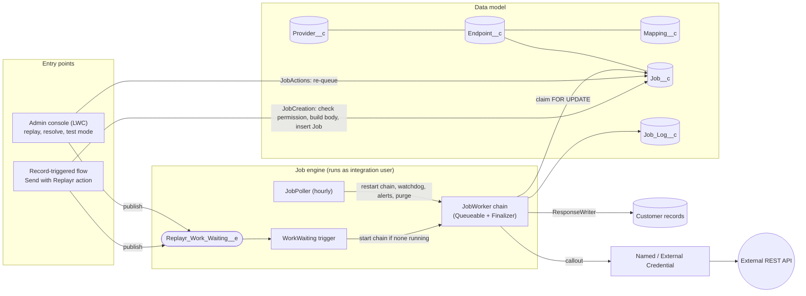
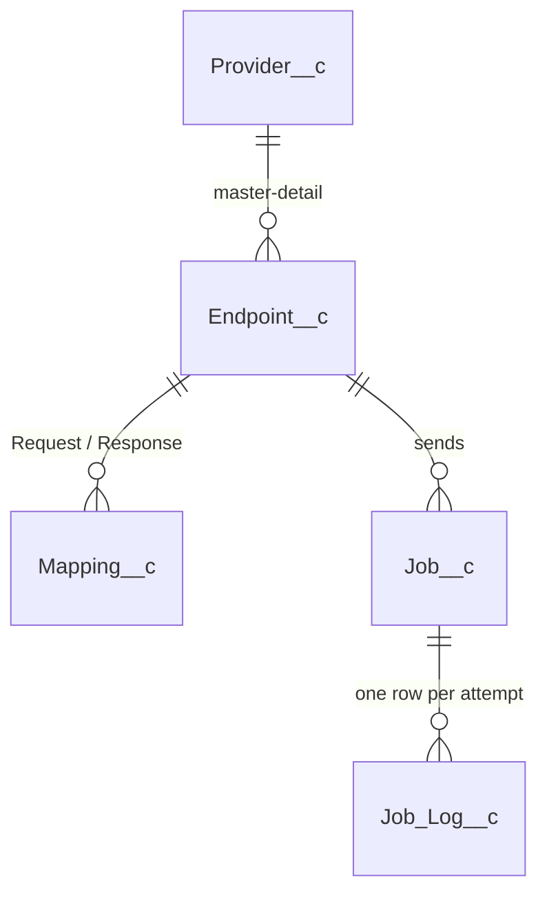
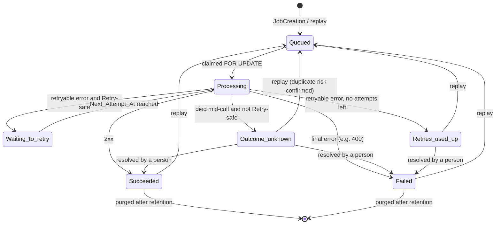
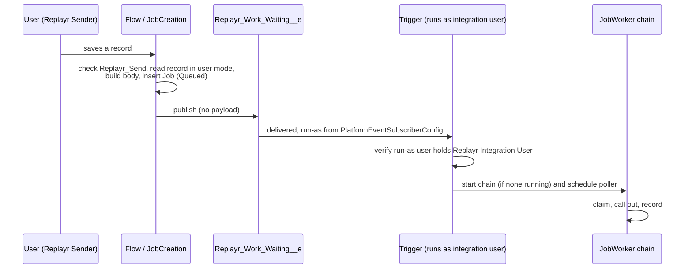

# Architecture

Replayr is a 2GP managed package that sends Salesforce records to external REST APIs, declaratively. The hard part isn't making the callout. It's making callouts trustworthy inside a multi-tenant platform that can kill your transaction at any moment, retries nothing for you, and runs async work as whichever user happened to start it.

This document covers how the package is put together. The reasoning behind individual choices is in [decisions.md](decisions.md); spike and ADR numbers below refer to it.

## Design goals

1. **Never lose a call.** Every send becomes a persisted job before anything goes over the wire.
2. **Never duplicate a call by accident.** Automatic retry only happens where the admin has declared it safe, and a manual replay that could duplicate says so.
3. **Always know what happened.** Every attempt is logged. When the platform makes the outcome unknowable, the job says *Outcome unknown* and asks a person; it never guesses.
4. **Least privilege.** Credentials live only in Named and External Credentials. One integration user holds callout access, and people hold only what their role needs.
5. **Pass AppExchange security review** without asking for exceptions: CRUD/FLS everywhere, two narrowly scoped `without sharing` classes, and no secrets in package data.

## Component view

| Layer | Main classes | Responsibility |
| --- | --- | --- |
| Entry | `SendWithReplayr`, `JobCreation` | Global Flow action. Authorises the sender, reads the record in user mode, builds the request body from the mapping, inserts jobs. |
| Hand-off | `WorkWaiting`, `ReplayrWorkWaitingTrigger` | Moves work onto the integration user via a platform event (ADR-003). |
| Engine | `JobWorker`, `JobFinalizer`, `RetryPolicy`, `CalloutService` | Claim, call, record, decide on retry, chain to the next job. |
| Mapping | `MergeTemplate`, `FieldConverter`, `JsonPath`, `ResponseWriter` | Request templating, JSON path extraction, writing responses back to records. |
| Housekeeping | `JobPoller`, `JobWatchdog`, `JobAlerts`, `JobPurge` | Hourly safety net: restart stalled work, settle dead jobs, alert, enforce retention. |
| Console | `Console*` Apex, `replayr*` LWCs | Health, jobs, providers/endpoints, mappings, test mode, settings. |
| Cross-cutting | `Redactor`, `PermissionSetHolders`, `JobLogs`, `SettingsWriter` | Masking secrets in anything shown, role checks, logging, protected settings. |

## Data model

- **Provider**: one external system. It references a Named Credential *by name* and never holds a secret. It also carries the provider-specific masked field names.
- **Endpoint**: one remote operation (method and path), with its reliability contract: *Retry-safe*, *Side-effect-free*, maximum attempts, idempotency header, and whether flows may send to it.
- **Mapping**: a Request template or Response rules, stored as JSON on one record per direction.
- **Job**: one logical call, which outlives its attempts. It holds the frozen request body (so a replay sends exactly what was sent before), the idempotency key, status, and next attempt time.
- **Job Log**: one row per attempt, replay request or resolution.
- **`Replayr_Settings__c`**: a protected hierarchy custom setting for the poller heartbeat, run-as record, alert window and retention (ADR-011).

`Key__c` on Provider and Endpoint is the stable, org-independent handle used by flows and data loads (ADR-017).

## Job lifecycle

## How a call is made safely

Each `JobWorker` link is one Queueable transaction:

1. **Claim.** It locks a few candidate jobs with `SELECT ... FOR UPDATE`, re-checks their status after the lock, picks the oldest, marks it *Processing*, and commits. A competing claimer blocks and then gets the next free row, never the same one (P0.2).
2. **Attach a finalizer, then call out.** The callout comes before any DML in the transaction, as the platform requires. The request goes to `callout:<NamedCredential>/<path>`, so the platform injects authentication, and package code never sees a secret.
3. **Record the response on the finalizer first.** Immediately after the callout returns, the HTTP status and a bounded summary are stored on the finalizer instance. If the transaction then dies, even with an uncatchable `LimitException`, the finalizer still runs, sees that state, and records the real result (P0.3). A call that reached the remote system is never resent because of a crash on our side.
4. **Write.** It updates the job, writes the log row and applies the Response mapping.
5. **Decide on retry.** `RetryPolicy` retries only Retry-safe endpoints and only on timeouts, connection errors, 408, 429 and 5xx. It uses exponential backoff (1, 2, 4, 8 minutes, ±20% jitter) and honours `Retry-After` up to 24 hours. Waits of up to 10 minutes use a delayed Queueable; longer waits are picked up by the hourly poller (P0.1).
6. **Chain.** It enqueues the next link. If the platform's chain-depth limit refuses the enqueue (5 links in Developer and Trial orgs), the link releases its claim and publishes the work-waiting event, and a fresh chain continues (ADR-004).

If both the worker and its finalizer vanish, the **watchdog** (run by the poller) settles jobs stuck in *Processing* for over an hour. A Retry-safe job gets another attempt, and anything else becomes *Outcome unknown* for a person to resolve.

## Identity and the integration-user hand-off

Async Apex runs as whoever started it (P0.4), so a record saved by a sales rep would otherwise make its callout as that rep, who has no credential access and shouldn't have any. Replayr moves all work onto a single integration user:

The event carries no data. It only says that work is waiting, because the jobs are already committed. If the subscriber config hasn't been set up yet, the trigger runs as Automated Process, records that fact for the health panel, and does nothing else. Jobs wait safely instead of failing.

The integration user can be on the free **Salesforce Integration** licence. It needs Replayr's Integration User permission set plus the customer's own grant of principal access and Read on `UserExternalCredential`, which Salesforce strips from packaged permission sets (P0.5).

## Security model

| Concern | Approach |
| --- | --- |
| Credentials | Named and External Credentials only. Providers store a credential *name*. There is no wizard that handles secrets (ADR-023). |
| Secret injection | `{!` is rejected in templates, rules and every merged value, so neither a mapping nor record data can make the platform expand `$Credential` into a body (ADR-006). |
| CRUD/FLS | `WITH USER_MODE` / `AccessLevel.USER_MODE` throughout. System mode only in explicitly commented, narrow places. |
| Sharing | `with sharing` by default. Two private inner `without sharing` classes (`JobActions.PrivilegedWriter`, `JobCreation.PrivilegedAccess`), each acting only after a custom-permission check (ADR-012, ADR-018). |
| Authorization | Custom permissions `Replayr_Send` and `Replayr_Manage_Jobs` at each entry point, not trust in the calling context. Endpoints must be opened to senders one by one. |
| Information leakage | One generic error for every configuration reason a send fails. Admins diagnose with test mode. |
| Display | `Redactor` masks known and admin-listed secret names in everything the console shows, and fails closed when it can't (ADR-014, ADR-022). |
| Dynamic SOQL | Bind variables only. Object and field names are validated against describe results. |

Permission sets: **Admin** (configure everything), **Operator** (view, replay, resolve), **Sender** (send records through flows), **Integration User** (run jobs).

Scanner evidence and the justification for each remaining finding are in [security-review.md](security-review.md).

## Governor limits by design

- **Bulk:** no SOQL or DML in loops. The gate tests prove it at the extremes: `Phase2GateTest` builds 200 request bodies with nested JSON in one transaction, and `Phase4aGateTest` sends 200 records through the Flow action with bodies near the 131,072-character maximum and a write-back access check per record.
- **Async budget:** one chain per org, one job per link. Each link makes one callout and a handful of DML statements.
- **Scheduled jobs:** exactly one (`JobPoller`). Purge, alerts and the watchdog all run from it, so Replayr barely touches the org's 100-scheduled-job allowance.
- **Platform events:** at most one per transaction, carrying no payload.
- **Heap:** request bodies are loaded one job at a time, just before the callout, and response data held on the finalizer is bounded.

## Quality gates

GitHub Actions runs on each pull request: Salesforce Code Analyzer, ESLint and Jest (with coverage) for the LWCs, and, once Dev Hub login secrets are configured, a fresh scratch org that deploys the package, runs every Apex test with coverage, and is then deleted. Merges to `main` build a beta package version.

Before each beta I also click through the console in an installed subscriber org, because neither Apex tests nor Jest catch a failing LWC-to-Apex call (see [apex-notes.md](apex-notes.md#lightning-web-components-calling-apex)).
